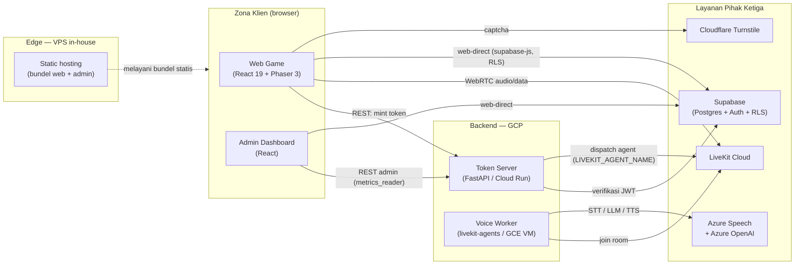
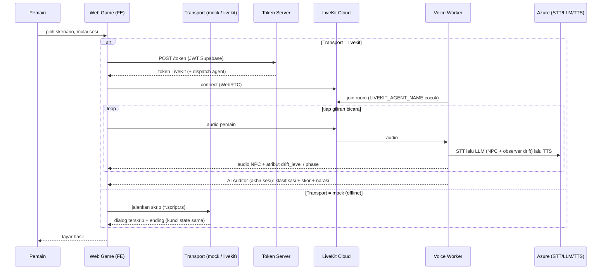

# Arsitektur Simulasi Koperasi

Simulasi Koperasi adalah game edukasi berbasis web di mana pemain berlatih situasi
koperasi (mis. Rapat Anggota Tahunan) lewat percakapan suara dengan NPC ber-AI. Dokumen
ini untuk **insinyur baru**: baca ini lebih dulu untuk memahami seluruh sistem dari atas
sebelum masuk ke kode.

**Terakhir diverifikasi: 2026-10-16**

## Tujuan & batasan arsitektur

Beberapa gaya yang menjelaskan *kenapa* arsitekturnya begini:

- **Latensi rendah untuk suara** — percakapan NPC harus terasa real-time; pipeline suara
  (STT → LLM → TTS) berjalan di worker terpisah, bukan di request web biasa.
- **Boot tanpa env (offline-first)** — aplikasi harus bisa jalan tanpa konfigurasi apa pun;
  transport **default `mock`** memakai percakapan terskrip, tanpa backend/jaringan.
- **Skenario adalah data, bukan kode** — menambah skenario = menambah data (profil + skrip),
  bukan menyentuh mesin percakapan.
- **Kecepatan handover** — monorepo pnpm dengan batas tanggung jawab yang jelas per app,
  sehingga sistem bisa dipahami dan diserahterimakan cepat.

## Peta monorepo

Workspace **pnpm** (`apps/*`, `packages/*`), Node ≥22. `apps/backend` adalah proyek
Python yang dikelola **uv**, bukan pnpm.

| Path | Peran | Dokumen |
|------|-------|---------|
| `apps/web` | Game utama (Vite + React 19 + Phaser 3 + Zustand 5 + Tailwind v4) | [`apps/web/README.md`](apps/web/README.md) |
| `apps/admin` | Dashboard admin (React, tanpa Phaser/LiveKit) | *(belum ada README — gap diketahui)* |
| `apps/web-sementara` | Harness validasi pipeline suara (legacy; referensi impl `LiveKitTransport`) | [`apps/web-sementara/README.md`](apps/web-sementara/README.md) |
| `apps/backend` | Token server (FastAPI) + voice worker (livekit-agents) | [`README.md`](apps/backend/README.md) · [`CLAUDE.md`](apps/backend/CLAUDE.md) · [`CONTRACT.md`](apps/backend/CONTRACT.md) |
| `apps/db` | `@simkop/db`: skema/migrasi/seed/pgTAP Supabase/Postgres | [`README.md`](apps/db/README.md) · [`RUNBOOK.md`](apps/db/RUNBOOK.md) · [`DATA-MODEL.md`](apps/db/DATA-MODEL.md) |
| `packages/catalog` | `@simkop/catalog`: konten JSON bersama (dipakai `apps/web` + seed db) | — |

## Diagram topologi runtime

Siapa berjalan di mana, dan siapa bicara dengan siapa saat mode `livekit` aktif. Bundel
frontend dilayani VPS in-house; saat runtime browser langsung bicara ke GCP, LiveKit,
Supabase, dan Turnstile.

## Alur sebuah sesi

Dalam mode `livekit`, frontend meminta token ke token server (yang memverifikasi JWT
Supabase dan men-dispatch agent), lalu menyambung ke room LiveKit. Voice worker join ke
room yang sama (cocok lewat `LIVEKIT_AGENT_NAME`) dan menjalankan pipeline Azure
STT → LLM → TTS tiap giliran bicara, sambil mengirim atribut seperti `drift_level` dan
`phase` ke frontend. Di akhir sesi, AI Auditor menghasilkan klasifikasi + skor + narasi.
Dalam mode `mock`, tidak ada jaringan: frontend menjalankan skrip terskrip dengan kunci
state yang sama seperti hasil nyata.

## Konsep kunci

### Transport seam (mock vs livekit)

Inti percakapan berjalan di balik satu antarmuka `SessionTransport`
([`apps/web/src/session/transport/contract.ts`](apps/web/src/session/transport/contract.ts)).
UI hanya ditulis terhadap kontrak ini — tak pernah mengimpor transport konkret. Transport
dipilih di satu tempat,
[`createTransport.ts`](apps/web/src/session/transport/createTransport.ts), berdasarkan
`ENV.transport` ([`config/env.ts`](apps/web/src/config/env.ts)); **default `mock`**,
sedangkan `livekit` butuh `VITE_TOKEN_ENDPOINT`.

Catatan akurasi: **skrip mock
([`session/transport/mock/scripts/*.script.ts`](apps/web/src/session/transport/mock/scripts/))
adalah sumber kebenaran ending** (`GOOD_ENDING`/`BAD_ENDING`);
[`resultLabels.ts`](apps/web/src/components/session/resultLabels.ts) hanya *superset* label
tampilan — sebuah label bisa ada tanpa pernah diemisikan skrip. Detail kontrak FE↔BE ada di
[`apps/backend/CONTRACT.md`](apps/backend/CONTRACT.md).

### Desain AI tiga lapis

Diimplementasikan di `apps/backend/voice_worker/`; sumber kebenaran lengkap ada di
[`apps/backend/CLAUDE.md`](apps/backend/CLAUDE.md) §"model state tiga lapis".

- **Lapis 1 — nada NPC real-time**: murni system prompt + ChatContext, tanpa pelacakan state
  (`voice_worker/prompts/`). Semua skenario.
- **Lapis 2 — observer drift**: `voice_worker/observer.py` — gpt-5-mini menilai tiap giliran
  pemain secara asinkron (escalate/neutral/deescalate) → `drift_level` 0/1/2 dipublikasikan
  ke FE sebagai atribut partisipan; level 2 memaksa berhenti. Hanya skenario dengan spec `drift`.
- **Lapis 3 — AI Auditor**: `voice_worker/auditor.py` — gpt-5.4 sekali di akhir sesi, membaca
  transkrip penuh + taksonomi → JSON (klasifikasi + skor + narasi). Hanya skenario dengan spec
  `auditor`; tutorial memakai hasil terskrip.

Nama model datang dari env, bukan hardcode.

### Split akses database

`apps/web` adalah satu-satunya konsumen DB saat runtime (web-direct via `supabase-js`,
dijaga RLS). Backend menyentuh DB **hanya** lewat pool asyncpg `metrics_reader` yang
fail-soft, dan hanya untuk endpoint admin (metrik, analitik, leaderboard, manajemen konten,
ekspor CSV, kode misi). Jalur suara/token sendiri bebas-DB.

## Catatan deployment (ringkas)

Permukaan deployment lengkap ada di [`docs/deploy/README.md`](docs/deploy/README.md)
(sumber kebenaran env: [`production-config.md`](docs/deploy/production-config.md)). Ringkas:
frontend di **VPS in-house**; backend di **GCP** (token server di Cloud Run + voice worker
di GCE VM); DB + auth di **Supabase**; suara via **LiveKit Cloud + Azure**; captcha via
**Cloudflare Turnstile**.

Dua fakta operasional yang perlu terlihat dari atas (keduanya dari
[post-mortem container deploy](docs/solutions/deployment-issues/backend-container-deploy-smoke-surprises.md)):

- **Discovery agent**: `LIVEKIT_AGENT_NAME` harus sama persis di token server dan voice
  worker. Jika beda, token tetap sukses tapi worker tak pernah join room → sesi hang senyap.
- **Health check**: `/health` bersifat *config-blind* (selalu balas 200, hanya liveness —
  bukan bukti konfigurasi benar); voice worker meng-expose health di port `:8081` (disediakan
  framework livekit-agents).

## Indeks dokumen

| Dokumen | Baca ini saat… |
|---------|----------------|
| [`apps/web/README.md`](apps/web/README.md) | mengerjakan game/UI frontend |
| [`apps/backend/CLAUDE.md`](apps/backend/CLAUDE.md) | mengerjakan voice worker / desain AI 3 lapis |
| [`apps/backend/CONTRACT.md`](apps/backend/CONTRACT.md) | menyentuh kontrak FE↔BE (RPC, atribut, data shapes) |
| [`docs/how-to-add-a-scenario.md`](docs/how-to-add-a-scenario.md) | menambah skenario baru (FE + BE + CONTRACT + katalog + DB) |
| [`apps/db/DATA-MODEL.md`](apps/db/DATA-MODEL.md) | perlu skema/ERD database |
| [`apps/db/RUNBOOK.md`](apps/db/RUNBOOK.md) | menjalankan migrasi/seed database |
| [`docs/deploy/`](docs/deploy/) | men-deploy atau mengubah konfigurasi produksi |
| [`docs/solutions/`](docs/solutions/) | mencari post-mortem / pelajaran dari bug lampau |
| [`docs/qa/`](docs/qa/) | menjalankan regresi QA manual |
